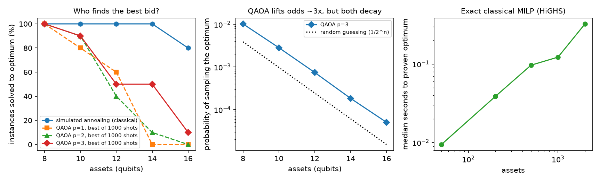

# flexcast: what is a day-ahead price forecast worth to an Estonian battery?

**Paper:** [paper/flexcast_paper.pdf](paper/flexcast_paper.pdf), *What Is a Price Forecast Worth to a Battery? A Pre-Registered, Decision-Focused Study of Day-Ahead Forecasting for Baltic Flexibility, with a Quantum-Optimisation Benchmark for mFRR Bid Assembly.* Five pre-registered experiments: v1, v2 weather, v3 and v4 profit training, and quantum bids.

**Quantum vs classical for mFRR bid assembly** (`quantum_bids.py`, pre-registered). The task is choosing which on/off assets form a 1 MW bid at minimum cost, posed as a QUBO.

- **QAOA (p ≤ 3, exact noiseless simulation):** it samples the optimal bid about 3× more often than random guessing. Its success falls from 100% at 8 assets to 10% at 16.
- **Simulated annealing:** solves 96% of instances.
- **Exact MILP:** proves optimality for **2,000 assets in 0.32 s**.



This project forecasts tomorrow's 24 hourly Estonian (EE) day-ahead prices using only what is known at the 12:00 CET gate closure. It then schedules a 1 MW / 2 MWh battery on each forecast and settles the result at the real prices.

The test window is 191 days (1 Apr – 8 Oct 2026). It was pre-registered and run once.

| | "same as yesterday" | best forecast (ensemble) |
|---|---|---|
| MAE (€/MWh) | 42.3 | **30.7** (−27%, CI of gain 8.2–15.1) |
| Battery profit, 191 days | €12,760 | **€26,630** |
| Share of perfect-foresight profit | 31% | **65%** |
| Gain per day per MW | – | **+€73** (95% CI 53–102) |
| Losing days | 44 | 13 |

**The finding that matters most (exploratory, after the test):** a plain "average of each hour over the last 28 days" profile captures the **same 65%** in euros. The difference is −€0.39/day, CI −6.1 to +5.3, even though the models are 23% more accurate than that profile. For day-ahead arbitrage, the daily price *shape* does almost all the work. More euros need new information (balancing data, real asset data) or a different training target (v3 below), not just a more accurate model.

**v2: adding weather forecasts (pre-registered second look).** The weather inputs are archived forecasts issued before gate closure.

- **Accuracy:** MAE improved to €29.3/MWh, 31% better than naive. The weather effect alone is −€1.6 (CI 0.2–2.8).
- **Capture:** 66.3% in summer. That is not a statistically clear gain over the profile (+€2.3/day, CI −2.9 to +7.2).
- **Winter:** in the winter validation window the models beat the profile by **+€16/day (CI 4–25)**, because wind makes the daily shape irregular.
- **Takeaway:** accuracy alone doesn't pay. The next step is to train the forecast for the battery decision, not for MAE.

**v3: train the forecast for profit, not for error (SPO+, pre-registered).** This is the same linear model on the same data; only the training loss changes.

- **Profit:** **+€6.56 per day per MW (95% CI 3.5–9.6)**, capture 61.7% → 64.8%, at a slightly worse MAE (+€0.35). It is the first change in the study that moved euros rather than accuracy.
- **Against the profile:** built on that weak base model it still ties the 28-day profile (−€0.94/day, CI −6.2 to +3.8). Putting it on the stronger model is the next experiment.

**v4: SPO+ on the stronger asinh model failed (pre-registered).** It was numerically unstable: 9 of 18 configs diverged, and the best lost €4.36/day to its own starting point. The cause and the fix are in the paper.


**Live clean test:** `python run.py live` scores the frozen models on every delivery day after 8 Oct 2026, data nothing in this repo has seen.

Two things did not work, and both are reported:

- **The trust gate:** my pre-registered gate was far too cautious and idled the battery on every day.
- **The quantum reservoir:** the simulated 8-qubit reservoir did not beat a same-size random-feature control.

The full write-up, with confidence intervals, limits and next steps, is in [report/REPORT.md](report/REPORT.md).


## Run it

```
python -m venv .venv
.venv/Scripts/pip install -r requirements.txt      # on Linux/macOS: .venv/bin/pip
python run.py validate    # tunes on Oct 2025 – Mar 2026, writes results/chosen_config.json
python run.py test        # runs the frozen configs on the test window once
python extras.py          # pre-registered H3 + exploratory tables
python run.py figures
python run.py validate_w  # v2: weather forecasts (Open-Meteo, cached in data/raw)
python run.py test_w      # needs PREREGISTRATION_v2.md
python run.py validate_p  # v3: profit-trained (SPO+) grid, about 30 min
python run.py test_p
python run.py validate_v4 && python run.py test_v4    # v4: SPO+ on the asinh model
python quantum_bids.py    # quantum vs classical bid assembly (about 10 min); --figure for the chart
python paper/build_pdf.py # rebuild the paper (needs `pip install markdown` and Edge/Chrome)
python run.py live        # frozen models on new days after 8 Oct 2026
pytest                    # battery LP, quantum reservoir, and a no-look-ahead test for features
```

Data comes from Elering's public dashboard API (no key needed) and is cached in `data/raw/`.

## Layout

```
src/flexcast/
  data.py       download + cache Elering prices and system data; CET market days; 15-min -> hourly
  features.py   one row per delivery day, only information known at 12:00 CET on D-1
  models.py     naive, LEAR, LightGBM (point + quantile), ridge, echo-state network,
                quantum-reservoir and random-feature maps with a shared ridge readout
  qrc.py        exact statevector simulation of an 8-qubit transverse-field Ising reservoir
  battery.py    LP schedule (scipy/HiGHS) and settlement at actual prices
  weather.py    archived day-ahead weather forecasts (Open-Meteo, issued 48 h ahead)
  decision.py   batched DP battery solver + SPO+ training (forecast trained for profit)
  qubo.py       mFRR bid assembly as a QUBO: exhaustive, simulated annealing, QAOA statevector, MILP
paper/          the research paper (Markdown source, PDF, build script)
  backtest.py   rolling-origin evaluation, weekly refits
  evaluate.py   MAE/RMSE, moving-block bootstrap CIs, interval coverage
run.py          validate / test / figures
extras.py       H3 and exploratory analyses from saved test forecasts
PREREGISTRATION*.md  v1, v2 and v3, each frozen before its test; SHA-256s stored in the results
results/        validation grid, test metrics, forecasts, daily profits
figures/        charts used in the report
tests/          unit tests
```

## Honest notes

- **Market scope:** day-ahead only. There is no mFRR/aFRR/FCR, intraday or bid-curve modelling yet. Weather is a 7-point public proxy.
- **Reused test window:** v2, v3 and v4 are later looks at the v1 test window, as their pre-registrations say. `run.py live` is the clean test going forward.
- **Simplified battery:** each day is optimised on its own, with a flat €5/MWh degradation cost and no grid fees.
- **Hourly resolution:** quarter-hour prices (since 1 Oct 2025) are averaged to the hour.
- **Research prototype:** this has tests, but it is not a production service.

Author: Mouadh Abderrahmane Assal, thereviewboost@gmail.com
