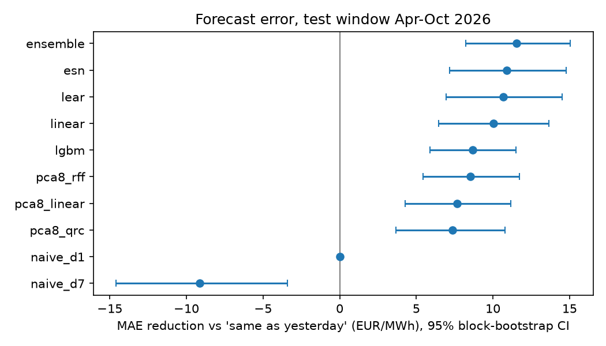
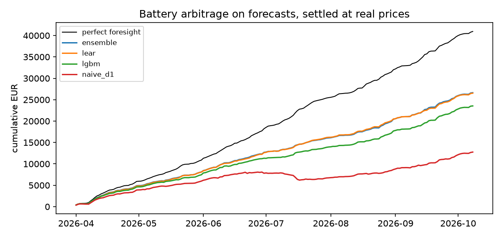
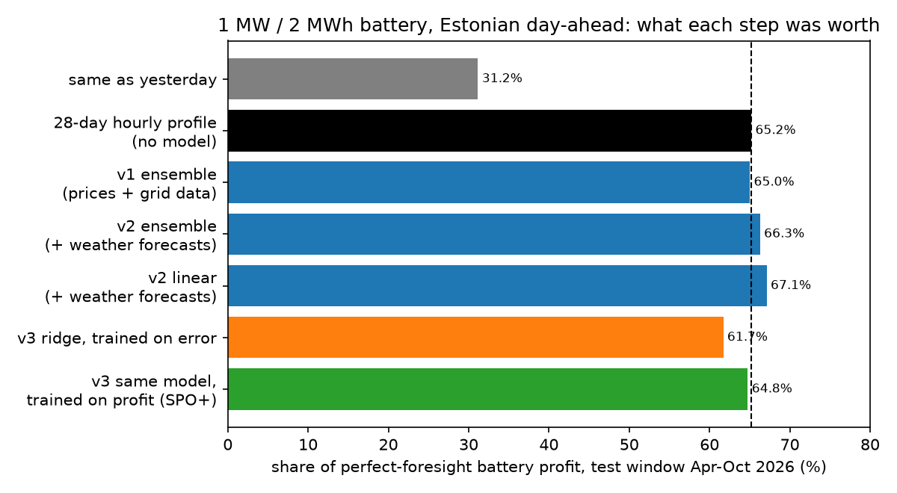

# What is a price forecast worth to a battery in Estonia?

*A pre-registered backtest on public Baltic data, April – October 2026.*
*Mouadh Abderrahmane Assal · October 2026*

## Summary

- **The question.** I forecast tomorrow's 24 hourly Estonian day-ahead prices using only what is known at the 12:00 CET gate closure. I then scheduled a 1 MW / 2 MWh battery on each forecast and settled it at the real prices.
- **The test.** 191 days (1 Apr – 8 Oct 2026). Pre-registered before any model saw it, used once.
- **Forecast error.** The best forecast (an equal-weight average of LEAR, LightGBM and an echo-state network) cut the error of "same as yesterday" by 27%: MAE €30.7 against €42.3/MWh. The 95% CI of the gain is €8.2–15.1/MWh.
- **Battery profit.** Scheduling on that forecast earned **€26.6k against €12.8k** for the same battery on "same as yesterday". That is 65% of the perfect-foresight profit against 31%: **+€73 per day per MW (95% CI €53–102)**.
- **But the euros come from the daily shape, not the model (exploratory, found after the test).** A plain profile, "average price of each hour over the last 28 days", captures the **same 65%**. The difference is −€0.39/day (CI −6.1 to +5.3). The better forecast is 23% more accurate than that profile (MAE €30.7 against €39.9), yet it earns no more money. For day-ahead arbitrage, accuracy past the shape isn't worth euros. The remaining value needs new information: weather, balancing signals, the asset's own data.
- **Losing days.** These fell from 44 to 13.
- **What failed.** My pre-registered trust gate failed: it was far too cautious and idled the battery on every day. The LightGBM 80% interval was miscalibrated, covering only 57% of outcomes. Both are reported below with the reasons.
- **The quantum reservoir.** As pre-registered, the simulated 8-qubit quantum reservoir did **not** beat a random-feature control of the same size. It was €1.19/MWh worse (CI €0.42–2.24).
- **v2, weather forecasts:** they cut MAE to €29.3/MWh but added no measurable euros (§3b).
- **v3, training for profit (SPO+):** the same linear model earns **+€6.56/day per MW (CI 3.5–9.6)** more when trained on profit instead of squared error. That is the first change in this study that moved euros, not just accuracy. Built on a weak base model, it still only ties the 28-day profile (§3c).

## 1. Setup

**Data.** All data comes from Elering's public API (dashboard.elering.ee), with no key, from January 2023 to 8 October 2026:

- Nord Pool day-ahead prices for EE, FI, LV and LT.
- Estonian system actuals: consumption, production, renewables, solar and AC balance.

Quarter-hour prices (since 1 Oct 2025) are averaged to hours. Market days follow CET/CEST, like SDAC.

**Information set.** For delivery day D the features use only data known at 12:00 CET on D-1:

- EE prices for D-1, D-2 and D-7
- FI prices for D-1
- Lithuanian and Finnish spreads on D-1
- system actuals for the full day D-2 only
- calendar: weekday, Estonian holidays, season, and a flag for the 9 Feb 2025 synchronisation with Continental Europe

**No weather forecasts are used.** A unit test checks that changing anything about day D leaves day D's features unchanged.

**Models.**

| name | what it is |
|---|---|
| `naive_d1`, `naive_d7` | same as yesterday, same as last week |
| `lear` | LASSO-estimated autoregressive model, one LASSO per hour, asinh-transformed, average of 364- and 728-day windows. Open benchmark from Lago et al. (2021) |
| `lgbm` | LightGBM on a day×hour table, L1 loss. Quantile versions (q10, q90) give the uncertainty band |
| `linear` | ridge regression on the same standardised features |
| `esn` | echo-state network (400 units) run over the sequence of days, with a ridge readout |
| `ensemble` | equal-weight mean of `lear`, `lgbm`, `esn`, members fixed in advance |
| `pca8_qrc` | simulated 8-qubit transverse-field Ising reservoir on 8 PCA components: 108 features, ridge readout |
| `pca8_rff` | null control: 108 random cosine features of the same 8 inputs, same readout |
| `pca8_linear` | ridge on the same 8 inputs |

**Protocol.**

- **Rolling origin.** Each model is refitted every 7 days on all history before the block.
- **Tuning.** Hyperparameters were chosen on a separate validation window (1 Oct 2025 – 31 Mar 2026), with grids widened until no optimum sat on a grid edge.
- **Freezing.** The configuration was then frozen and hashed into `PREREGISTRATION.md`. The test run records the SHA-256 of that file (`c63dd3e1…`), so any later edit would be visible.
- **Confidence intervals.** These come from a 7-day moving-block bootstrap of daily differences.

**Battery.** 1 MW / 2 MWh with:

- 90% round-trip efficiency
- 50% state of charge at the start and end of each day
- €5/MWh throughput cost

Its schedule is the exact LP optimum for the forecast prices, and profit is counted at the actual prices. "Capture" means realised profit divided by perfect-foresight profit. Perfect foresight earned €40,954 over the 191 days, about €214/day.

## 2. Results (test window, 191 days)

| model | MAE €/MWh | RMSE | MAE gain vs naive_d1 (95% CI) | battery profit € | capture | € gain/day vs naive_d1 (95% CI) | losing days |
|---|---|---|---|---|---|---|---|
| **ensemble** | **30.7** | 41.1 | 11.6 (8.2 – 15.1) | 26,630 | 65.0% | 72.6 (53.2 – 101.9) | 13 |
| esn | 31.4 | 41.3 | 10.9 (7.2 – 14.8) | **26,833** | **65.5%** | 73.7 (55.0 – 101.5) | 12 |
| lear | 31.6 | 42.0 | 10.7 (6.9 – 14.5) | 26,532 | 64.8% | 72.1 (51.9 – 101.9) | 19 |
| linear | 32.2 | 41.9 | 10.0 (6.4 – 13.7) | 26,526 | 64.8% | 72.1 (53.9 – 99.5) | 11 |
| lgbm | 33.6 | 45.2 | 8.7 (5.9 – 11.5) | 23,542 | 57.5% | 56.5 (38.6 – 83.9) | 15 |
| pca8_rff | 33.7 | 43.9 | 8.5 (5.4 – 11.7) | 26,148 | 63.9% | 70.1 (51.5 – 97.4) | 13 |
| pca8_linear | 34.6 | 44.2 | 7.7 (4.3 – 11.2) | 25,793 | 63.0% | 68.2 (50.7 – 93.9) | 17 |
| pca8_qrc | 34.9 | 44.5 | 7.4 (3.7 – 10.8) | 26,371 | 64.4% | 71.3 (52.7 – 97.2) | 14 |
| naive_d1 | 42.3 | 59.5 | – | 12,760 | 31.2% | – | 44 |
| naive_d7 | 51.4 | 70.0 | −9.1 (−14.6 – −3.4) | 16,711 | 40.8% | 20.7 (7.8 – 38.5) | 26 |




**Pre-registered hypotheses**

| | prediction | outcome |
|---|---|---|
| H1 | LightGBM and LEAR beat naive_d1 on MAE, CI excluding 0 | **Held.** Every model did |
| H2 | the lowest-MAE model earns more than naive_d1, CI excluding 0 | **Held.** +€72.6/day (53.2 – 101.9) |
| H3 | the quantum reservoir does not beat the same-size random-feature control | **Held.** QRC is worse by €1.19/MWh (0.42 – 2.24), and indistinguishable from plain linear on the same 8 inputs (+0.30, −0.60 – 1.42) |
| H4 | the trust gate cuts losing days with < 5% profit change | **Failed.** It idled the battery on 191 of 191 days |
| Calibration | 80% band covers 70 – 90% | **Failed.** 56.5% |

## 3. What I take from it

1. **Most of the value is in moving off naive, and even that is mostly the daily shape.** The top five models lie within each other's CIs, and plain ridge on the same features captures 64.8%.
   - *Exploratory:* a 28-day hourly profile, with no model at all, also captures 65.2%. All my models land at Kendall τ ≈ 0.52 between forecast and actual hour ranking. A 2026 preprint reports that capture approaches 97–100% only above τ ≈ 0.85–0.95.
   - So what the forecast *knows* matters far more than which model class is used. The next gains are weather, 15-minute data, balancing signals and asset data, not deeper networks.
2. **MAE and euros disagree at the margin.** LightGBM's MAE is close to the others, but it captures 7–8 points less profit. My unverified guess is that the L1 objective flattens the evening peaks the battery sells into. That gap is a reason to tune forecasts on a decision metric, not only on MAE.
3. **Naive scheduling can lose money for a whole month.** In July "same as yesterday" had a *negative* capture (−14.7%), while the ensemble captured 46.5% (exploratory, see `results/exploratory_monthly.csv`).
4. **The gate failed for a clear reason.** Re-pricing every hour at its own worst quantile assumes every error goes against you at once, which is too pessimistic. And the band it relied on was under-dispersed (57% coverage), so it was not trustworthy anyway.
   - *Exploratory:* even a perfect gate could have added at most 0.8% to the ensemble's profit, because its 13 losing days lost only €202 in total. For "same as yesterday" the same ceiling is 26%. So for day-ahead arbitrage, a good forecast already does most of a gate's job.
   - *Where a gate matters:* in balancing markets, where Baltic prices have hit the ±€10,000/MWh cap. A useful gate there needs correlated whole-day error scenarios and calibrated intervals (e.g. conformal), not independent per-hour quantiles.
5. **Quantum reservoir.** At this size, with exact simulation, it behaves like a mediocre random-feature model. That is consistent with my earlier QRCx result, where a linear baseline matched the quantum model. I would not put it in a product today.

### Where this sits (exploratory, added after the test)

| reference | share of perfect-foresight profit |
|---|---|
| "same as yesterday" (this study) | 31% |
| persistence, 2026 multi-market preprint | 33% |
| **this study: best models** | **65%** |
| **this study: trailing 28-day hourly profile, no model** | **65%** |
| month-hour average known in advance (oracle yardstick, this study) | 69% |
| month-hour average, European day-ahead study | 78% |
| published forecast + optimiser studies | 66% – 98% |

The literature figures use different markets, battery sizes and profit definitions, so treat them as rough bands, not a league table.

In money, on this test window and annualised, for 1 MW / 2 MWh doing day-ahead arbitrage only:

| | €/MW/year |
|---|---|
| "same as yesterday" | ~€24k |
| best model or 28-day profile | ~€51k |
| perfect foresight | ~€78k |

For scale, Clean Horizon's index put a 2-hour Estonian battery at about €152k/MW/year in August 2026, all revenue streams included. A local aggregator (Volton) estimates spot arbitrage at only 5–15% of a typical Estonian battery's revenue, with mFRR capacity the largest line. The money is mostly in balancing, which this study does not cover.

## 3b. v2: adding weather forecasts

This section is pre-registered in `PREREGISTRATION_v2.md`. Because the test window was already seen in v1, v2 is a **second look, not a clean test**.

**Inputs.** Archived day-ahead weather forecasts from Open-Meteo's Previous Runs API. Each was issued 48 h before its valid hour, so before gate closure. They cover:

- wind at two Finnish wind clusters, West Estonia and the Lithuanian coast, converted with a turbine-curve proxy
- temperature and solar radiation in Tallinn, Helsinki and Vilnius

The archive starts in March 2024, so the weather models train on shorter history. The `_nw` ablation uses the same rows without weather.

**Test window (191 days, summer–autumn 2026)**

| model | MAE €/MWh | capture | losing days |
|---|---|---|---|
| **ensemble_w (with weather)** | **29.3** | **66.3%** | 16 |
| ensemble_nw (same rows, no weather) | 30.9 | 64.7% | 15 |
| v1 ensemble | 30.7 | 65.0% | 13 |
| linear_w | 31.4 | 67.1% | 12 |
| trailing 28-day profile | 39.9 | 65.2% | 16 |
| naive_d1 | 42.3 | 31.2% | 44 |

**Hypotheses**

| | prediction | outcome |
|---|---|---|
| W1 | weather lowers MAE (same rows) | **Held.** −€1.61/MWh (CI 0.19 – 2.80) |
| W2 | with weather, the models earn more than the 28-day profile | **Not shown.** +€2.33/day (CI −2.92 – +7.20). This matched my written prediction: small positive, CI touching 0 |
| W3 | capture, no threshold | 66.3% vs 65.2% (profile) and 65.0% (v1) |

**The seasonal split.** This is descriptive, and on the validation window, which was used for tuning, so it is mildly optimistic.

| | winter, Oct 2025 – Mar 2026, 182 days | summer, Apr – Oct 2026, 191 days |
|---|---|---|
| models vs 28-day profile, € per day | **+16.0 (CI 4.0 – 25.4)** | +2.3 (CI −2.9 – 7.2) |
| capture: ensemble_w / profile | 67.8% / 62.6% | 66.3% / 65.2% |
| weather vs no weather, MAE | −4.9 €/MWh | −1.6 €/MWh |
| weather vs no weather, capture | 67.8% vs 68.3% | 66.3% vs 64.7% |

**What it means.**

1. **In winter, models are worth money over a simple profile.** Wind swings make the daily shape irregular, and a model tracks it while an average can't.
2. **In summer, the solar-driven shape is regular enough that the profile already gets it.**
3. **Weather made forecasts more accurate in both seasons but did not add euros in either.** That is the second time in this study that accuracy did not turn into money. The next step is not more inputs but **training for the decision**: a loss that rewards ranking the hours correctly, or the battery profit itself, instead of MAE. The two preprints cited above argue the same.

## 3c. v3: training the forecast for profit (SPO+)

This section is pre-registered in `PREREGISTRATION_v3.md`. It is a third look at the seen test window.

**The idea.** Since accuracy kept failing to turn into euros, I trained a forecast directly on the battery decision. SPO+ (Elmachtoub & Grigas, 2022) is a convex loss that measures how much profit a forecast loses *through the schedule it causes*. Each training step needs the optimal schedule for every training day, so `decision.py` adds a batched dynamic program that solves a whole year in milliseconds. On true prices it reaches 98.6% of the exact LP optimum, and there is a unit test for that.

**The model.** A linear model on the v2 features (prices, grid data, weather forecasts) in raw price space:

- **`ridge_raw_w`:** trained on squared error. This is the starting point and the control.
- **`spo_w`:** the same model, fine-tuned on SPO+ from that starting point.

Hyperparameters were picked by validation profit. Because the first grid's alpha sat on its edge, alpha = 30 was added and re-checked before freezing.

**Test window (191 days)**

| model | MAE €/MWh | capture | profit € | losing days |
|---|---|---|---|---|
| v2 linear_w (asinh ridge + weather) | 31.4 | **67.1%** | 27,487 | 12 |
| v2 ensemble_w | **29.3** | 66.3% | 27,148 | 16 |
| trailing 28-day profile | 39.9 | 65.2% | 26,704 | 16 |
| **spo_w (trained for profit)** | 30.8 | **64.8%** | 26,525 | 16 |
| ridge_raw_w (same model, trained for error) | 30.4 | 61.7% | 25,272 | 18 |

**Hypotheses**

| | prediction | outcome |
|---|---|---|
| P1 | SPO+ beats its own error-trained start in euros | **Held, more strongly than predicted.** +€6.56/day per MW (CI 3.53 – 9.61), lifting capture by 3.1 points. On a 1 MW battery that is about €2,400 a year, from changing only the training loss |
| P2 | SPO+ beats the 28-day profile in euros | **Not shown**, as predicted. −€0.94/day (CI −6.16 – +3.80) |
| P3 | it costs some accuracy | **Held.** MAE +€0.35/MWh (CI 0.17 – 0.55) |

**What it means.**

1. **Training for the decision works, and it is now measured.** The same model, inputs and data earned clearly more once its loss counted euros instead of price error, even though its MAE got slightly worse.
2. **It started from the weakest base.** The raw-price ridge captures only 61.7%, against 67.1% for the asinh ridge on the same inputs. SPO+ closed most of that gap but not all of it.
3. **The obvious next experiment** is SPO+ on top of the stronger asinh model or the ensemble, with real asset data. If the +3-point lift carries over, it would clear the profile. That is a hypothesis, not a result.



## 4. Limits

- **Day-ahead only.** There is no intraday re-trading, no mFRR, aFRR or FCR, and no bid curves. Elering's open balancing endpoint returns empty values, and the Baltic Transparency Dashboard blocked automated download.
- **Weather only in v2, coarsely.** It is added in v2 as 7 grid points from one archived model. There are no TSO load or renewable forecasts.
- **Hourly resolution.** The real market has been quarter-hourly since 1 Oct 2025.
- **Simplified battery.** Each day is optimised on its own, with a flat degradation cost, no grid fees, and no state-of-charge carry-over between days.
- **One test window.** Six months, spring to autumn 2026. Winter behaviour is only in the validation window.
- **Research code.** It is a research prototype with unit tests, not a production service.

## 5. Next steps (what I would do with Fusebox data)

1. **Real asset, real resolution, trained for profit.** Run on one real asset at 15-minute resolution, with proper weather forecasts. Put SPO+ on the stronger model. Measure value in euros against the current Fusebox OS schedule.
2. **Balancing leg.** Add mFRR activation prices and direction, then split capacity between day-ahead and mFRR under uncertainty.
3. **A working gate.** Build calibrated intervals (conformal) and whole-day error scenarios, then a gate with escalation to an operator. Test it where it matters: balancing.
4. **A service.** Wrap the result as a small service behind an API that Fusebox OS can call, with drift monitoring.

## Reproduce

```
python -m venv .venv && .venv/Scripts/pip install -r requirements.txt
python run.py validate    # a few minutes on a laptop, writes results/chosen_config.json
python run.py test        # about a minute, needs PREREGISTRATION.md
python extras.py          # H3 and exploratory tables
python run.py figures
python run.py validate_w && python run.py test_w     # v2: weather forecasts
python run.py validate_p && python run.py test_p     # v3: trained for profit (about 30 min)
python run.py live                                   # frozen models on new days after 8 Oct 2026
pytest
```

- Elmachtoub, Grigas (2022). *Smart "Predict, then Optimize".* Management Science 68(1).

The raw API responses are cached in `data/raw/`, so results reproduce even if Elering revises values.

**Benchmarks cited in "Where this sits".** These are from search summaries; check them before quoting.
- *When Forecast Accuracy Fails: Rank Correlation and Decision Quality in Multi-Market Battery Storage Optimization*, arXiv 2604.12082 (2026)
- *Price Information Is Not Enough: Ordering and Decision Rules in Storage Bidding*, arXiv 2608.08377
- *A Comparative Analysis of Price Forecasting Methods for Maximizing Battery Storage Profits*, Energies 18(13):3309 (2025)
- ESS News, *Battery revenues rise everywhere in Europe other than Baltics in August 2026* (Clean Horizon index)
- Volton, *How Much Can You Really Earn with a Battery on Estonia's Flexibility Markets?*

**References.**
- Lago, Marcjasz, De Schutter, Weron (2021). *Forecasting day-ahead electricity prices: A review of state-of-the-art algorithms, best practices and an open-access benchmark.* Applied Energy 293.
- Uniejewski, Weron, Ziel (2018). *Variance stabilizing transformations for electricity spot price forecasting.* IEEE Trans. Power Systems 33(2).
